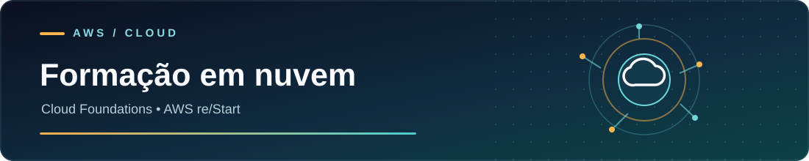

## Fala! 👋

Sou o Daniel, estudante de **Engenharia de Software**. Gosto de pegar uma ideia, montar a primeira versão e ir resolvendo os problemas que aparecem pelo caminho — seja numa API, numa interface ou até num ESP32.

Aqui tem de tudo um pouco: projetos autorais, experimentos e exercícios que fiz para aprender. Alguns já têm uma aplicação navegável; outros ainda estão em desenvolvimento. Prefiro mostrar o processo e o código do que fingir que está tudo pronto.

## ☁️ Formação AWS

  

  

    
    &nbsp;&nbsp;&nbsp;
    
  

  
<strong>AWS Academy · Cloud Foundations</strong> &nbsp; | &nbsp; <strong>AWS re/Start · Graduate</strong>

  
Fundamentos de nuvem, arquitetura AWS, redes e segurança

## 🛠️ O que eu uso nos projetos

  

Não uso todas essas tecnologias no mesmo projeto. Gosto especialmente de **back-end, bancos de dados, APIs e integrações**, mas também curto cuidar da parte visual quando faz sentido.

## 🚀 Projetos para conhecer

<table>
<tr>
<td width="50%" valign="top">

### 🍽️ FoodBridge

Uma ideia para aproximar quem tem alimentos para doar de organizações que precisam deles. Tem autenticação, cadastro de organizações e interface web.

**Kotlin · Spring Boot · PostgreSQL · React**

[Ver API](https://github.com/DanieldeAlmeida2024/FoodBridge-API-Kotlin) · [Ver frontend](https://github.com/DanieldeAlmeida2024/Foodbridge-Frontend-React)

</td>
<td width="50%" valign="top">

### ⚽ Panini Cards Check

Uma aplicação simples de usar: marcar as figurinhas que você já tem, conferir as que faltam e controlar repetidas no navegador.

**Vite · TypeScript · Python**

[Explorar o projeto](https://github.com/DanieldeAlmeida2024/Panini-Cards-Check)

</td>
</tr>
<tr>
<td width="50%" valign="top">

### 🔐 Modulock

Meu experimento com controle de acesso físico: ESP32, leitor RFID e uma interface de administração. Ainda precisa de validação de segurança no hardware antes de qualquer uso real.

**C++ · ESP32 · RFID · PlatformIO**

[Ver o código](https://github.com/DanieldeAlmeida2024/Modulock)

</td>
<td width="50%" valign="top">

### 🚚 Rastreamento de Veículos · Full Cycle

Sistema distribuído de rastreamento: interface web, API de rotas, simulação de deslocamentos e troca de eventos via Kafka. Os módulos são organizados em repositórios conectados por Git submodules e Docker Compose.

**Go · NestJS · Next.js · Kafka · MongoDB**

[Ver o sistema completo](https://github.com/DanieldeAlmeida2024/Sistema-de-rastreamento-de-veiculos---Curso-Full-Cycle-2.0-)

</td>
</tr>
</table>

<b>🔎 Mais coisas que ando construindo e estudando</b>

- **Chronicle:** um RPG de mundo persistente, com simulação, regras de servidor e integrações. O código está em repositório privado.
- **[AnimeDex](https://github.com/DanieldeAlmeida2024/AnimeDex):** testes com addons, metadados e integrações usando Supabase.
- **[Laboratório de banco de dados](https://github.com/DanieldeAlmeida2024/banco-de-dados):** prática de persistência e CRUD em Python.
- **[Todos os repositórios](https://github.com/DanieldeAlmeida2024?tab=repositories):** incluindo exercícios de Java, Python e automação de testes.

## 📈 Um pouco da minha atividade por aqui

<b>📚 O que eu estou estudando agora</b>

- Arquitetura de software, separação de responsabilidades e testes automatizados.
- Java, Python e desenvolvimento de APIs.
- Cloud, deploy, bancos de dados e observabilidade.
- Integrações entre aplicações, serviços e dispositivos.

---

**Quer conversar sobre código ou algum projeto?**

[LinkedIn](https://linkedin.com/in/daniel-de-almeida-b498531b2) · [E-mail](mailto:danieldealmeidadev@outlook.com) · [Repositórios](https://github.com/DanieldeAlmeida2024?tab=repositories)

O perfil está sempre mudando — assim como os projetos.

